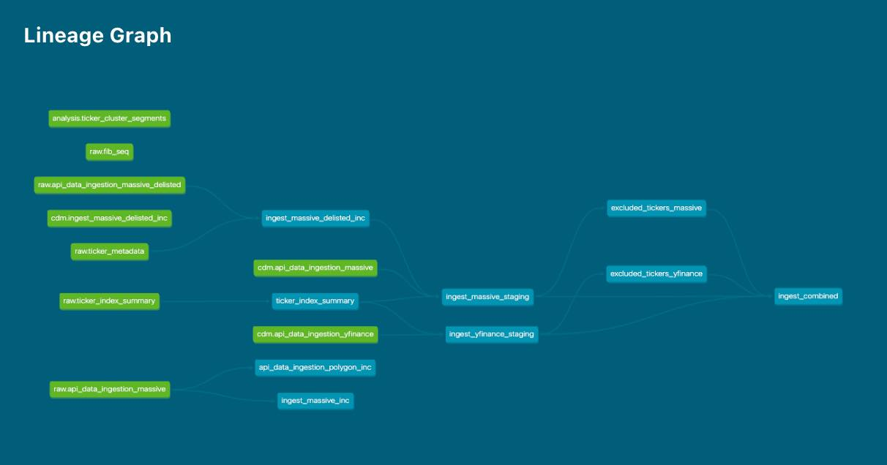
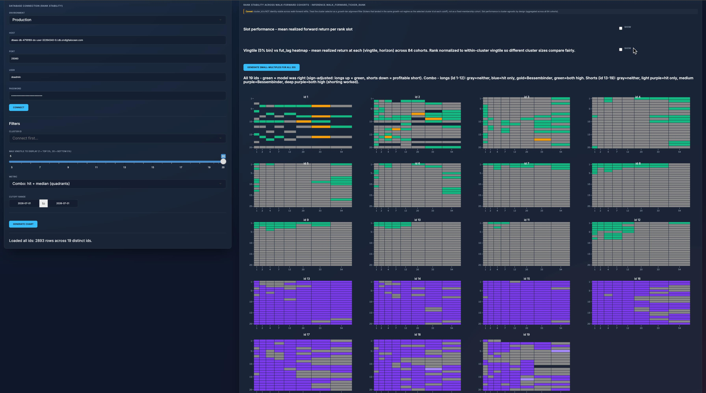
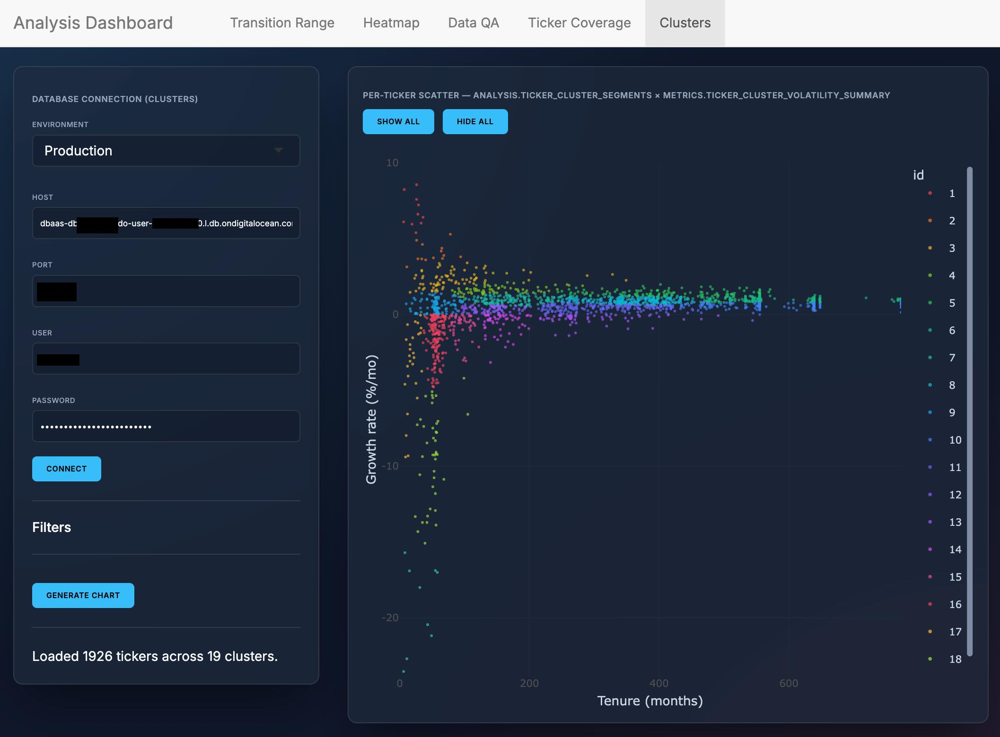

# AlphaStream

AlphaStream turns market data into stock calls and tests each call against history. It cleans prices into one trusted table. It groups stocks that move alike and scores every group. It replays the past to rate each score. An AI grader reviews each pick. A front end shows it all.

## Status

The build is done and runs in the cloud on a schedule.

An audit in October 2026 found that the backtest could see past its own cutoff dates. On honest data the stock picker shows no proven edge. The group signal holds up: falling groups keep losing. Picking winners inside the rising groups is what fails. Model buys are stopped.

Work now goes into a new input. Company fundamentals from SEC filings are built and tested for look-ahead. Valuation and quality measures come next.

## The system

Five layers. Data sits at the center.

| Layer | What it does |
|---|---|
| **Data** | Brings in prices and company filings. Cleans them. Builds the groups and scores. Replays history to rate them. |
| **Backend** | Runs every job on a clock. Grades picks. Keeps the book. Sends alerts. |
| **Frontend** | Shows the board and the calls. Shows the checks on the model and the data. |
| **Infra** | A cloud server and a managed database. A Mac mirrors it for local work. |
| **Dev tools** | The code, the tests and the deploy steps behind every layer. |

## Repositories

- **elt-canonical-data** (this repo, public). The data intake: prices, company filings and the clean tables everything reads. Also the shared jobs and the docs.
- **elt-inference-models** (private). The models: groups, scores, history replay and the daily calls.
- **qualstream** (private). The AI grader. It grades each pick with one call that sees only data from that date. Every grade can be replayed.

## Pipeline

Data comes in and passes quality checks. It becomes one clean price per stock per day. From there it feeds the groups and the scores. A history replay rates each score before it reaches the front end. The AI grader runs beside it and feeds the same front end.

## Data lineage

### Clean data

From raw feeds to the clean tables every model reads.

### Models and scores

Groups, scores and history replay on top of the clean tables.

## Front end

One app with views for three jobs. Decide what to hold. Check the model. Check the data. Built with R and Shiny.

### Lifecycle

The board. Each pick sits in one column: enter, hold or exit. It also tracks the book against the market.

### Forecast

Follows the picks forward from any past date. Compares them with the market and the backtest. It warns that the backtest can see ahead.

### Predictions

Replays each past pick. Shows whether it beat the market.

### Rank Stability

Shows how each rank slot did in every group. The October audit found it does not measure rank skill.

### Clusters

Every stock on one chart. Stocks that move alike share a color.

### Transition Range

Compares each group's past moves with what came next.

## Timeline

### Data
- **2024.** First pipeline and the clean price model.
- **2025.** New price provider. All sources merged into one pipeline. Standard measures over the full history.
- **2026 Q2.** Delisted stocks added to remove survivorship bias. History replay rates every score.
- **2026 Q3.** Calls limited to proven ranks. The rules frozen as a live test.
- **2026 Q4.** Audit finds the backtest saw ahead. No proven edge in stock picking. Company fundamentals added from SEC filings.

### Backend
- **2024.** Jobs move onto a scheduler.
- **2026 Q3.** AI grader added. The board runs itself each day. Every stage sends alerts. Watchdogs catch stalled runs and missed syncs.
- **2026 Q4.** Model buys stopped. The monthly replay now pauses the daily model run.

### Frontend
- **2026 Q2.** First views for ranges, coverage and clusters.
- **2026 Q3.** Backtest replay with a live log. The Lifecycle board.
- **2026 Q4.** Look-ahead warning on the backtest views.

### Infra
- **2024.** Separate dev and staging databases.
- **2025.** Jobs move to the cloud.
- **2026 Q1.** Everything runs in containers. Hosting moves to DigitalOcean with a managed database.
- **2026 Q4.** The front end gets its own container.

### Dev tools
- **2024.** Python, dbt and Airflow.
- **2026 Q1.** Code split into a public repo and private ones.
- **2026 Q3.** Test rules written down before each test runs.

### Next
- Build valuation and quality measures from the fundamentals.
- Test them for an edge with the same look-ahead rules.

## Documentation

- [Architecture and Design](docs/architecture.md)
- [Development Guide](docs/development_guide.md)
- [Operations Manual](docs/operations_manual.md)
- [Company Fundamentals](docs/edgar_fundamentals.md)
- [Security](docs/security.md)
- [Cheat Sheet](docs/cheat_sheet.md)
