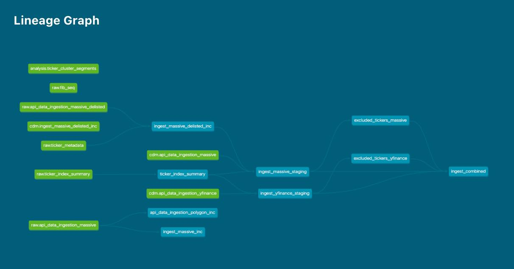
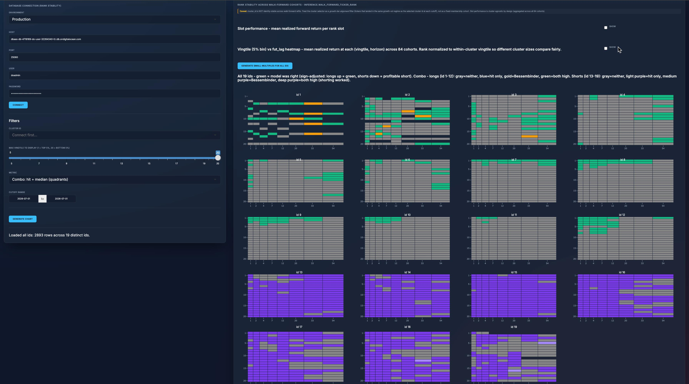
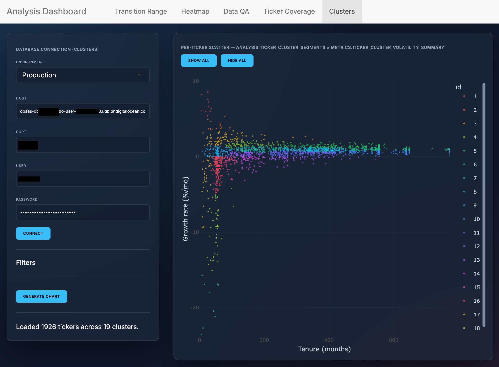

# AlphaStream

AlphaStream is a data system. It ranks the items it follows and tests whether its top selections beat a benchmark.

It collects daily data for each item and cleans it. It sorts the items into groups by how long each has existed and how fast it has grown. It ranks the items inside each group, and its selections come from the top of those rankings. To check itself it runs the same method on past years and measures how the selections would have done. That check is called a backtest. An AI model also grades each selection on a fixed scorecard. The results appear in a web app, called the front end below.

The benchmark is the baseline that every selection is measured against.

## Status

The system is built. It runs once a week on one Mac. Until November 2026 it ran every day on a cloud server. That server has been retired.

In October 2026 an audit found a flaw in the backtest. A backtest should stand on a past date and use only what was known on that date. This one also used data from after that date. That made the selections look better than they were. Tested again without the flaw, the selections show no proven edge. There is no evidence that they beat the benchmark.

One part held up. Groups that had been falling kept losing. Choosing the winners inside the rising groups is the part that failed. Acting on the model's selections has stopped.

The daily data alone has not been enough. The work now adds a second source, built from public filings. That data is loaded and checked. Each number is used only from the day after it was filed, so a test cannot see it early. New measures built from it come next.

## The system

The system has five parts.

| Part | What it does |
|---|---|
| **Data** | Collects the daily data and the filings and cleans them. Builds the groups and the rankings. Runs the backtest. |
| **Backend** | Runs each job on a schedule. Runs the AI grading. Keeps the record of active selections. Sends a message when a job ends or fails. |
| **Front end** | A web app that shows the selections, the test results and the state of the data. |
| **Infra** | The machines it runs on. Today that is one Mac. Until November 2026 it was a rented cloud server and database. |
| **Dev tools** | The code, the tests and the release steps behind every part. |

## Repositories

The code is in three repositories.

- **elt-canonical-data** (this one, public). It collects the data and builds the clean tables that everything else reads. It also holds the scheduled jobs, the front end and the documents.
- **elt-inference-models** (private). The models. It builds the groups, ranks the items, runs the backtest and produces the selections.
- **qualstream** (private). The AI grader. It shows an AI model only what was known on the day of the selection. So any old grade can be produced again and checked.

## Pipeline

The picture shows each step the data goes through, from left to right. Data comes in and is checked for errors. It becomes one clean value for each item on each day. From those values the system builds the groups and the rankings. The backtest then checks the rankings against past years. Its result decides how much each ranking is trusted. The AI grader works alongside. Both end up in the front end.

## How the tables connect

Each box is a table. A line shows that one table is built from another.

### Clean data

From the data as it arrives to the clean tables that every model reads.

### Models and scores

The groups, the rankings and the backtest, all built on the clean tables.

## Front end

The front end is one web app with eleven views. They follow four steps: check the data, study the groups, test the method and decide what to enter, hold or exit. It is built with R and Shiny.

Six of the views are shown below.

### Lifecycle

This is the main list. It sorts every active selection into enter, hold or exit. That means add it, keep it or drop it. It also tracks the active selections against the benchmark.

### Forecast

Choose any past date. The view follows that date's selections forward and draws them next to the benchmark. A second chart does the same for the selections recorded live since June 2026. A warning at the top says the backtest lines carry the flaw and the live record is the one to trust.

### Predictions

This view shows the current selections. For a past date it draws one bar for each selection. Green means the selection went on to beat the benchmark. Red means it fell behind. A dot marks an item that is no longer active.

### Rank Stability

There is one grid for each group. Rows run from the top of the ranking to the bottom. Columns are how long the selection was held. Green means the model was right. The October audit found the same flaw here. So this view does not show whether the ranking works.

### Clusters

Every item is one dot. Left to right is how long it has existed. Up and down is how fast it has grown. Dots of one color belong to one group. The app calls the groups clusters.

### Transition Range

This view takes one group and sorts its items by how they did in the past. For each level one box shows the range of past results. The box beside it shows the range of what came after.

## Timeline

### Data
- **2024.** The first version loads daily data and cleans it into one table.
- **2025.** The daily data moves to a new provider. Both sources feed one table. Each item's change is measured against the benchmark over its full history.
- **2026 Q2.** Items that are no longer active are added, so the history is not limited to the ones that lasted. The backtest is added.
- **2026 Q3.** Selections are limited to the ranking positions that did well in the backtest. The rules are locked and real results are recorded from then on.
- **2026 Q4.** An audit finds the flaw in the backtest. Without it the selections show no proven edge. A second data source is added from public filings.

### Backend
- **2024.** The jobs start running on a schedule.
- **2026 Q3.** The AI grader is added. The Lifecycle list updates itself each day. Every step sends a message when it ends. Separate checks send an alert if a run stalls or a data copy is missed.
- **2026 Q4.** Acting on the model's selections stops. The daily model run is made to wait while the monthly backtest runs.

### Front end
- **2026 Q2.** The first views show the range of outcomes, how much history each item has and the groups.
- **2026 Q3.** New views replay past selections and follow live ones. The Lifecycle list is added.
- **2026 Q4.** A warning about the flaw is added to the views that show backtest results.

### Infra
- **2024.** Two separate databases, one for building and one for testing.
- **2025.** The jobs move to a cloud server.
- **2026 Q1.** Every part is packaged so it runs the same way on any machine. Hosting moves to DigitalOcean, which also runs the database.
- **2026 Q4.** The front end is packaged on its own. The cloud server is retired in November. Everything now runs on one Mac, once a week.

### Dev tools
- **2024.** Python for the code, dbt for the table logic and Airflow for the schedule.
- **2026 Q1.** The code is split into this public repository and private ones.
- **2026 Q3.** The rules for judging each test are written down before it runs.

### Next
- Build new measures from the filings data.
- Test whether those measures improve the selections, using only what was known on each date.

## Documentation

- [Architecture and Design](docs/architecture.md)
- [Development Guide](docs/development_guide.md)
- [Operations Manual](docs/operations_manual.md)
- [Filings Data](docs/edgar_fundamentals.md)
- [Security](docs/security.md)
- [Cheat Sheet](docs/cheat_sheet.md)
